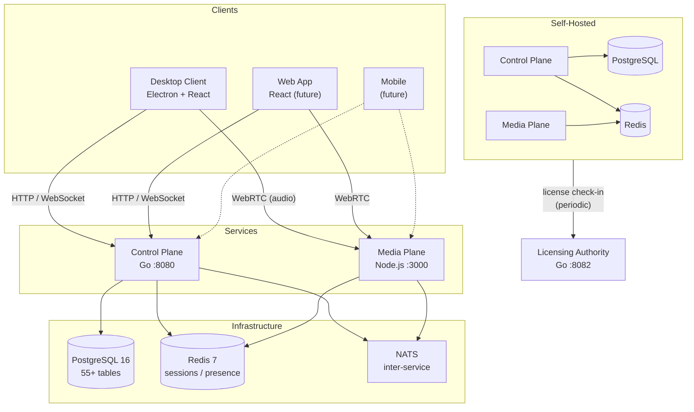
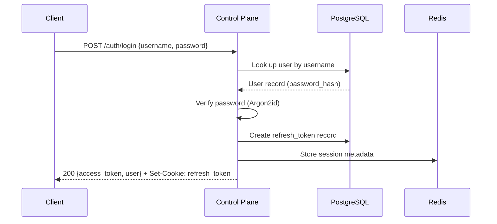
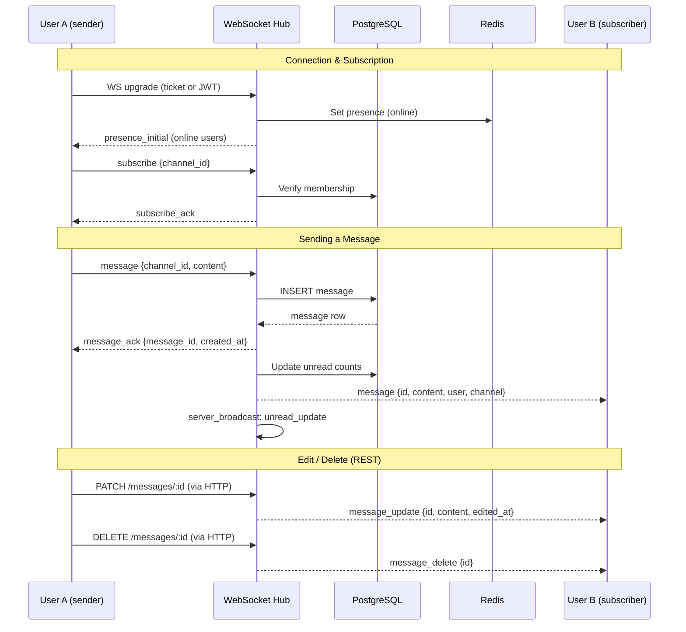
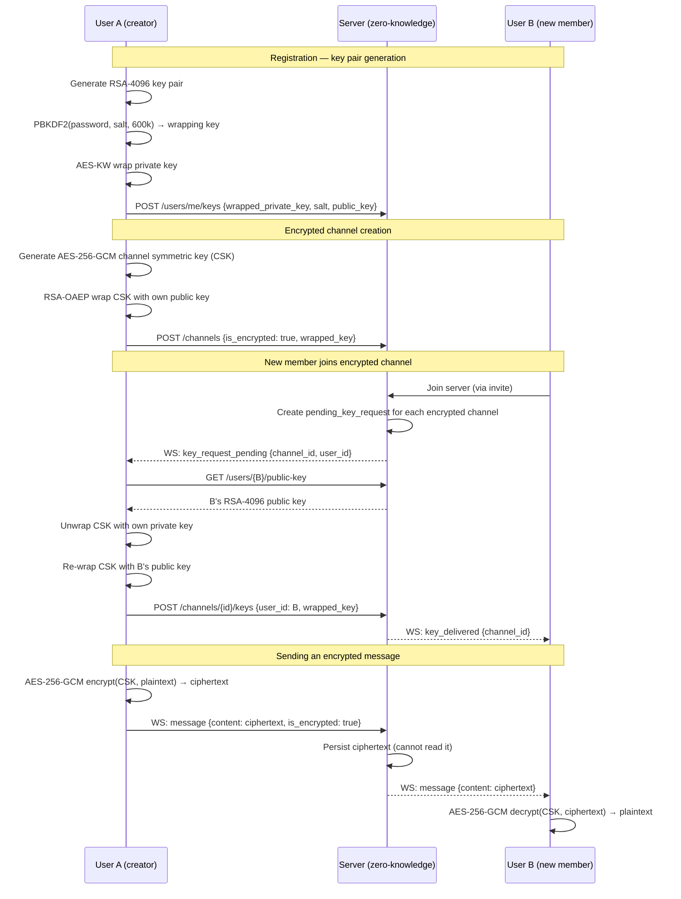

# Concord Voice Architecture

## Quick Overview

> Summary for AI assistants. For detailed diagrams and schema, see the sections below.

### System Overview

Concord Voice is a distributed real-time communications platform with three service planes:

```text
┌──────────────────────────────────────────────────────────────────┐
│  Desktop Client (Electron + React + TypeScript)                  │
│  - ~30 Zustand stores, E2EE via WebCrypto, safeStorage tokens   │
└──────┬────────────────────────────────┬──────────────────────────┘
       │ HTTP/WebSocket :8080           │ Socket.IO + WebRTC :3000
       ▼                                ▼
┌──────────────────────┐    ┌─────────────────────────────────────┐
│  Control Plane (Go)  │    │  Media Plane (Node.js + mediasoup)  │
│  Gin 1.12, 217 routes│    │  WebRTC SFU, Socket.IO signaling    │
│  Auth, RBAC, chat,   │    │  Voice/video routing, RoomManager   │
│  WebSocket hub       │    │  1 router per room, transport/user  │
└──────┬───────┬───────┘    └──────┬──────────────────────────────┘
       │       │                   │
       ▼       ▼                   ▼
┌──────────┐ ┌───────┐      ┌───────┐
│PostgreSQL│ │ Redis │      │ Redis │
│ 16 (57   │ │ 7     │      │ 5.0   │
│ migr's)  │ │       │      │       │
└──────────┘ └───┬───┘      └───┬───┘
                 │              │
                 └──── NATS ────┘
                   2.x (events)
```

### Service Responsibilities

#### Control Plane (Go + Gin, port 8080)

- User authentication (JWT access 15min + HttpOnly refresh 30d)
- Server/channel/member CRUD, RBAC permission enforcement
- WebSocket hub for real-time messaging and presence
- DM system (8 tables, E2EE with key-epoch enforcement)
- MFA (TOTP, WebAuthn), email verification, ownership transfer
- 217 REST endpoints across 25+ route groups

#### Media Plane (Node.js + mediasoup, port 3000)

- WebRTC SFU for voice and video (Opus codec, 7 quality tiers)
- Socket.IO signaling for transport negotiation
- `RoomManager` is authoritative for produce/consume/transport lifecycle
- NATS integration for participant state events to control plane

#### Desktop Client (Electron 41 + React 19)

- Secure IPC via preload bridge (contextIsolation ON, nodeIntegration OFF)
- E2EE: AES-256-GCM encryption, RSA-OAEP 4096-bit key wrapping
- Token storage via Electron safeStorage (OS keychain)
- ~30 Zustand stores for state management
- Auto-updater with splash screen, safety checks, rollback

### Data Flow

1. **Authentication:** Client → POST /auth/login → JWT pair → stored in safeStorage
2. **Messaging:** Client → WebSocket (ticket-auth) → hub routes to channel/DM subscribers
3. **E2EE:** Client encrypts (AES-256-GCM) → server relays ciphertext → recipient decrypts
4. **Voice:** Client → Socket.IO signaling → Media Plane (mediasoup SFU) → WebRTC transport → routed audio/video to other clients

### Infrastructure

- **Database:** PostgreSQL 16, 57 migrations, 55+ tables
- **Cache:** Redis for sessions, presence, RBAC cache, rate limiting
- **Messaging:** NATS 2.x for inter-service events
- **CI/CD:** GitHub Actions → SonarQube Quality Gate (≥ 80% coverage)
- **Security:** 22 pre-commit hooks, SAST (Semgrep), secret detection (gitleaks, TruffleHog)
- **Deployment:** Docker Compose (base + staging + production overlays)

### Key Design Decisions

- **Privacy-first:** E2EE by default, no server-side plaintext message storage
- **Hybrid deployment:** Same codebase for SaaS and self-hosted
- **Defense in depth:** Electron hardening + CSP + pre-commit secrets + SAST + SonarQube
- **Explicit over implicit:** All error paths handled, all state transitions visible

## Overview

Concord Voice is a distributed real-time communications platform with clear separation of concerns across three major planes:

1. **Client Layer** - User-facing applications
2. **Control Plane** - Business logic, auth, state management
3. **Media Plane** - WebRTC media routing
4. **Licensing Authority** - License management for self-hosted

## High-Level Architecture



## Component Details

### Client Layer

#### Desktop Client (Electron + React + TypeScript)
- **Technology**: Electron, React, TypeScript, mediasoup-client, WebRTC
- **Responsibilities**:
  - User interface (browser-inspired layout: server bar, folder bar, channel panel)
  - WebRTC media handling (Opus codec, 7 quality tiers)
  - Voice controls (mute/deafen/push-to-talk, audio device selection, per-user volume)
  - Noise suppression
  - Screen sharing (screen/window picker, viewer)
  - Video calls (camera toggle, video grid)
  - E2EE message encryption/decryption (AES-256-GCM)
  - Secure token storage (Electron safeStorage / OS keychain)
  - ~30 Zustand stores for state management (see `[internal]` for current count)
  - Error tracking via Sentry (production only; PII/key material scrubbed via `beforeSend`)
- **Communication**:
  - HTTP/WebSocket → Control Plane (signaling, auth, channels, presence)
  - Socket.IO → Media Plane (voice signaling)
  - WebRTC → Media Plane (audio/video streams)

#### Web Client (React + TypeScript)
- Same as desktop but without Electron wrapper
- Progressive Web App (PWA) capabilities
- Limited platform integration

### Control Plane (Go)

**Port**: 8080

**Tech Stack**:
- Go 1.26.1+
- Gin web framework
- PostgreSQL 16 (persistent data)
- Redis 7 (ephemeral state, sessions, rate limiting)
- gorilla/websocket (real-time messaging)

**Responsibilities**:
- User authentication (JWT)
- Server/channel CRUD operations
- Membership and permissions
- Billing and subscriptions
- User presence tracking
- WebSocket signaling for voice setup
- License validation coordination
- Rate limiting
- Moderation logic

**API**: 217 REST endpoints + 1 WebSocket endpoint across 25+ route groups (Auth, Users, Sessions, Servers, Channels, Messages, Members, Invites, E2EE, WebSocket, Friends, DM Conversations, Voice, MFA, RBAC, Media, Ownership, Email, Client Config, Updates). See [API Documentation](./api/README.md) for the OpenAPI 3.0 spec.

**Database Schema** (55+ tables across 57 migrations):

```mermaid
erDiagram
    users {
        UUID id PK
        VARCHAR email UK
        VARCHAR username UK
        TEXT password_hash
        BOOLEAN e2ee_preference
        VARCHAR display_name
        TEXT bio
        TEXT avatar_url
        JSONB links
    }
    user_keys {
        UUID user_id PK,FK
        BYTEA wrapped_private_key
        BYTEA key_derivation_salt
        INTEGER key_version
    }
    public_keys {
        UUID id PK
        UUID user_id FK
        BYTEA public_key
        INTEGER key_version
    }
    refresh_tokens {
        UUID id PK
        UUID user_id FK
        TEXT token_hash UK
        VARCHAR device_name
        INET ip_address
        TIMESTAMPTZ expires_at
        TIMESTAMPTZ revoked_at
    }
    user_preferences {
        UUID user_id PK,FK
        TEXT encrypted_data
        INTEGER version
    }
    servers {
        UUID id PK
        VARCHAR name
        UUID owner_id FK
        TEXT icon_url
        BOOLEAN e2ee_default
    }
    channels {
        UUID id PK
        UUID server_id FK
        VARCHAR name
        VARCHAR type
        VARCHAR emoji
        TEXT description
        INTEGER position
        BOOLEAN is_encrypted
    }
    server_members {
        UUID server_id PK,FK
        UUID user_id PK,FK
        VARCHAR role
        TIMESTAMPTZ joined_at
    }
    messages {
        UUID id PK
        UUID channel_id FK
        UUID user_id FK
        TEXT content
        BOOLEAN is_encrypted
        TIMESTAMPTZ edited_at
    }
    server_invites {
        UUID id PK
        UUID server_id FK
        VARCHAR code UK
        UUID created_by FK
        INTEGER max_uses
        INTEGER use_count
        BOOLEAN is_revoked
        TIMESTAMPTZ expires_at
    }
    channel_read_states {
        UUID user_id PK,FK
        UUID channel_id PK,FK
        TIMESTAMPTZ last_read_at
    }
    channel_keys {
        UUID id PK
        UUID channel_id FK
        UUID user_id FK
        TEXT wrapped_key
        INTEGER key_version
    }
    pending_key_requests {
        UUID id PK
        UUID channel_id FK
        UUID user_id FK
    }
    voice_participants {
        UUID id PK
        UUID channel_id FK
        UUID user_id FK
        TIMESTAMPTZ joined_at
    }
    friendships {
        UUID id PK
        UUID requester_id FK
        UUID addressee_id FK
        VARCHAR status
    }
    dm_conversations {
        UUID id PK
        BOOLEAN is_group
        VARCHAR name
        BOOLEAN is_encrypted
        UUID created_by FK
    }
    dm_participants {
        UUID conversation_id PK,FK
        UUID user_id PK,FK
        TIMESTAMPTZ joined_at
    }
    dm_messages {
        UUID id PK
        UUID conversation_id FK
        UUID user_id FK
        TEXT content
        BOOLEAN is_encrypted
        VARCHAR type
    }
    dm_read_states {
        UUID user_id PK,FK
        UUID conversation_id PK,FK
        TIMESTAMPTZ last_read_at
    }
    dm_channel_keys {
        UUID id PK
        UUID conversation_id FK
        UUID user_id FK
        TEXT wrapped_key
        INTEGER key_version
    }
    dm_pending_key_requests {
        UUID id PK
        UUID conversation_id FK
        UUID user_id FK
    }
    dm_voice_participants {
        UUID id PK
        UUID conversation_id FK
        UUID user_id FK
        TIMESTAMPTZ joined_at
    }

    users ||--o| user_keys : "has"
    users ||--o{ public_keys : "has"
    users ||--o{ refresh_tokens : "has"
    users ||--o| user_preferences : "has"
    users ||--o{ server_members : "joins"
    users ||--o{ messages : "sends"
    users ||--o{ server_invites : "creates"
    users ||--o{ channel_keys : "holds"
    users ||--o{ pending_key_requests : "requests"
    users ||--o{ channel_read_states : "tracks"
    users ||--o{ friendships : "has"
    users ||--o{ dm_participants : "participates"
    users ||--o{ dm_messages : "sends"
    users ||--o{ dm_channel_keys : "holds"
    servers ||--o{ channels : "contains"
    servers ||--o{ server_members : "has"
    servers ||--o{ server_invites : "has"
    servers }o--|| users : "owned by"
    channels ||--o{ messages : "contains"
    channels ||--o{ channel_read_states : "tracks"
    channels ||--o{ channel_keys : "has"
    channels ||--o{ pending_key_requests : "has"
    channels ||--o{ voice_participants : "has"
    dm_conversations ||--o{ dm_participants : "has"
    dm_conversations ||--o{ dm_messages : "contains"
    dm_conversations ||--o{ dm_read_states : "tracks"
    dm_conversations ||--o{ dm_channel_keys : "has"
    dm_conversations ||--o{ dm_pending_key_requests : "has"
    dm_conversations ||--o{ dm_voice_participants : "has"
```



Channel types: `text`, `voice`, `bulletin`

### Media Plane (Node.js + mediasoup) ✅ Implemented (Phase 1C)

**Port**: 3000
**RTC Ports**: 40000-49999 (UDP)

**Tech Stack**:
- Node.js 20+ / TypeScript
- mediasoup v3 (WebRTC SFU)
- Socket.IO (signaling)
- NATS (inter-service messaging with Control Plane)
- Redis (state sharing for multi-instance)

**Responsibilities**:
- WebRTC media routing (SFU architecture — no mixing/transcoding)
- ICE/STUN/TURN handling
- Audio forwarding with 7 quality tiers (Minimum 32kbps → Studio 510kbps)
- Room management (mediasoup routers, 1 per voice channel)
- Transport lifecycle management (auto-cleanup)
- Producer/Consumer management
- NATS event publishing (room state changes, participant join/leave)

**Architecture**:
```
mediasoup Worker Pool (1 per CPU core)
    ↓
Router (1 per voice channel/room)
    ↓
WebRTC Transports (2 per user: send + recv)
    ↓
Producers (outgoing audio) / Consumers (incoming audio)
    ↓
NATS ←→ Control Plane (room state sync, participant events)
```

**Socket.IO Events**:
- `join-room` - User joins voice channel
- `leave-room` - User leaves voice channel
- `create-transport` - Create WebRTC transport (send or recv)
- `connect-transport` - Connect transport via DTLS
- `produce` - Start sending audio
- `consume` - Start receiving audio from producer
- `set-quality` - Change voice quality tier
- `toggle-mute` / `toggle-deafen` - Audio state changes

### Licensing Authority (Go)

**Port**: 8082

**Tech Stack**:
- Go 1.26.1+
- PostgreSQL 16 (license records)
- Ed25519 cryptographic signing

**Responsibilities**:
- License generation (signed JWTs)
- License validation
- Periodic check-ins from self-hosted instances
- Revocation management
- Usage tracking

**License Structure** (JWT):
```json
{
  "license_id": "uuid",
  "customer_id": "uuid",
  "features": ["high-bitrate", "federation", "api-access"],
  "tier": "enterprise",
  "issued_at": "2024-01-01T00:00:00Z",
  "expires_at": "2025-01-01T00:00:00Z"
}
```

**Validation Flow**:
1. Self-hosted instance boots
2. Validates license signature locally (offline-capable)
3. Periodic check-in every 24-72 hours
4. Licensing authority validates and responds
5. If revoked, instance enters restricted mode (grace period)

## Data Flow Examples

### User Authentication



### WebSocket Message Flow



### Joining a Voice Channel

```
1. Client → POST /api/v1/channels/:id/join (HTTP)
           ↓
      Control Plane validates permissions
           ↓
      Returns: { allowed: true, media_server_url }

2. Client → WS connect to Media Plane
           ↓
      emit('join-room', { roomId, userId })
           ↓
      Media Plane creates Router (if needed)
           ↓
      Returns router RTP capabilities

3. Client creates WebRTC transports
   - Send transport (for microphone)
   - Recv transport (for speakers)

4. Client starts producing audio
   - Create Producer on send transport
   - Media plane forwards to other users

5. Other clients consume audio
   - Create Consumer for each Producer in room
   - Receive forwarded audio streams
```

### Voice Room Data Flow

```
User A (Speaking)
  Microphone → Opus Encode → WebRTC Send Transport
                                      ↓
                              Media Plane (SFU)
                             Router forwards packets
                                      ↓
                    ┌─────────────────┴──────────────┐
                    ↓                                ↓
            WebRTC Recv Transport          WebRTC Recv Transport
            Opus Decode → Speakers         Opus Decode → Speakers
                User B                            User C
```

No transcoding - audio packets are forwarded as-is (low latency, high quality).

## Deployment Models

### SaaS (Cloud-Hosted)

```
Users → Cloudflare/CDN → Load Balancer
                              ↓
                    ┌─────────┴─────────┐
                    ↓                   ↓
            Control Plane Pods    Media Plane Pods
            (Kubernetes)          (Kubernetes)
                    ↓                   ↓
                 Managed DB         Redis Cluster
              (RDS/Cloud SQL)
```

**Infrastructure**:
- Kubernetes (EKS/GKE/AKS)
- Managed PostgreSQL with read replicas
- Redis Cluster for HA
- Regional deployment for low latency
- Auto-scaling based on load

### Self-Hosted (Docker Compose)

```
Single Server or VM
┌──────────────────────────────┐
│  Docker Compose Stack        │
│  ┌────────────────────────┐  │
│  │ Control Plane          │  │
│  ├────────────────────────┤  │
│  │ Media Plane            │  │
│  ├────────────────────────┤  │
│  │ PostgreSQL             │  │
│  ├────────────────────────┤  │
│  │ Redis                  │  │
│  └────────────────────────┘  │
└──────────────────────────────┘
```

**Requirements**:
- 4+ CPU cores
- 8+ GB RAM
- 50+ GB storage
- Public IP for WebRTC
- UDP ports 40000-49999 open

### Self-Hosted (Kubernetes)

For larger self-hosted deployments:
- Helm charts for easy deployment
- Horizontal pod autoscaling
- Persistent volume claims for data
- Ingress for HTTPS termination
- Cert-manager for TLS

## Security Architecture

### Authentication & Authorization

**Current Implementation (Phase 1C complete)**:
- Email + password with Argon2id hashing
- Username validation with profanity filtering and leetspeak detection
- Username format: `username@concordvoice.chat` (federated identity)
- JWT access tokens (15-minute expiry)
- Refresh tokens (30-day expiry) in HttpOnly cookies
- Session management (list sessions, revoke sessions)
- Rate limiting (Redis-based, per-IP and per-user)
- E2EE key generation and storage (RSA-OAEP 4096-bit)

**Planned**:
- Magic link (passwordless)
- OAuth2 (Google, GitHub)
- 2FA via TOTP

**Self-Hosted (Phase 3)**:
- LDAP integration
- SAML 2.0 for enterprise SSO
- Custom identity providers

### Transport Security

- **Signaling**: TLS 1.3 (HTTP/WebSocket)
- **Media**: DTLS + SRTP (WebRTC)
- **E2EE**: Client-side encryption implemented
  - RSA-OAEP 4096-bit for key exchange
  - AES-256-GCM for message encryption
  - PBKDF2 with 600,000 iterations for key derivation
  - Public keys stored in PostgreSQL, private keys never leave client
  - E2EE → E2EE: Fully encrypted (maximum privacy)
  - E2EE → Non-E2EE: Messages sent in plaintext (user warned)

### E2EE Key Flow



### Data Privacy

- Minimal telemetry collection
- No biometric ID requirements
- No voice content retention
- Opt-in analytics only
- Clear data deletion policies
- GDPR/CCPA compliance (planned)
- Privacy-first architecture from day one

## Scalability Strategy

### Horizontal Scaling

**Control Plane**:
- Stateless (except Redis sessions)
- Scale behind load balancer
- Database connection pooling
- Read replicas for queries

**Media Plane**:
- Independent scaling from control plane
- Route users to nearest region
- Redis for cross-instance state
- Room sharding for large channels (100+ users)

**Database**:
- Read replicas
- Connection pooling (PgBouncer)
- Separate DBs for domains:
  - User/auth DB
  - Billing DB
  - Server/channel DB
  - Analytics DB (TimescaleDB)

### Geographic Distribution

```
Global Users
    ↓
Geographic DNS routing
    ↓
┌───────┬───────────┬────────┐
↓       ↓           ↓        ↓
US-East US-West   EU-Central APAC
(Media) (Media)   (Media)    (Media)
    ↓       ↓           ↓        ↓
    Central Control Plane (replicated)
    ↓
    Primary Database (with regional replicas)
```

## Performance Targets

### Latency
- **HTTP API**: < 100ms p99
- **WebSocket signaling**: < 50ms p99
- **Voice (same region)**: < 50ms end-to-end
- **Voice (cross-region)**: < 150ms end-to-end

### Capacity (per media plane instance)
- **Concurrent connections**: 1000+ transports
- **Active rooms**: 50+ routers
- **Total users in voice**: 2000+

### Database
- **Query time**: < 10ms p95
- **Connection pool**: 25 max, 5 idle

## Monitoring & Observability

### Metrics (Prometheus)

**Control Plane**:
- Request rate, latency, errors
- Active users, sessions
- Database query performance
- JWT validation rate

**Media Plane**:
- Active workers, routers, transports
- CPU per worker
- Network I/O (UDP traffic)
- Room sizes, concurrent users

### Logging (Loki + Grafana)

- Structured JSON logs in production
- Correlation IDs for request tracing
- Error tracking with stack traces

### Error Tracking (Sentry)

- **Desktop client**: Sentry SDK active in production; PII/key material scrubbed via `beforeSend` before any data leaves the process
- **Control plane / Media plane**: Sentry integration planned (follow-up issues)

### Tracing (Jaeger)

- Distributed traces across services
- WebRTC setup flow tracing
- Database query tracing

## Disaster Recovery

### Backup Strategy
- **Database**: Daily snapshots + continuous WAL archiving
- **Redis**: RDB snapshots (optional, ephemeral data)
- **License keys**: Encrypted backup in secure storage

### Recovery Procedures
- Database restore from snapshot
- Recreate Redis (sessions lost, users re-login)
- Redeploy services from Docker images

## Technology Decisions Summary

| Component | Technology | Rationale |
|-----------|-----------|-----------|
| Client Desktop | Electron + React + TS | Proven, fast development, mature WebRTC |
| Client Web | React + TS | Code sharing with desktop |
| Control Plane | Go + Gin | Fast, concurrent, easy to deploy |
| Media Plane | Node.js + mediasoup | Best WebRTC SFU library |
| Database | PostgreSQL | Relational data, JSON support, mature |
| Cache | Redis | Fast, pub/sub, sessions |
| Auth | JWT | Stateless, widely supported |
| Deployment | Kubernetes + Docker | Standard, portable, scalable |
| GIF Search | Klipy (privacy proxy) | Privacy-preserving GIF integration; tenant key + server-side proxy, no direct client calls to Klipy API |

## Next Steps

- [API Documentation](./api/README.md) — OpenAPI 3.0 spec (partial: 88 operations documented; 217 routes implemented — full spec regeneration planned)
- [Development Guide](./development.md) — Local setup, running tests
- [Self-Hosting Guide](./self-hosting.md) — Deployment instructions (planned)
