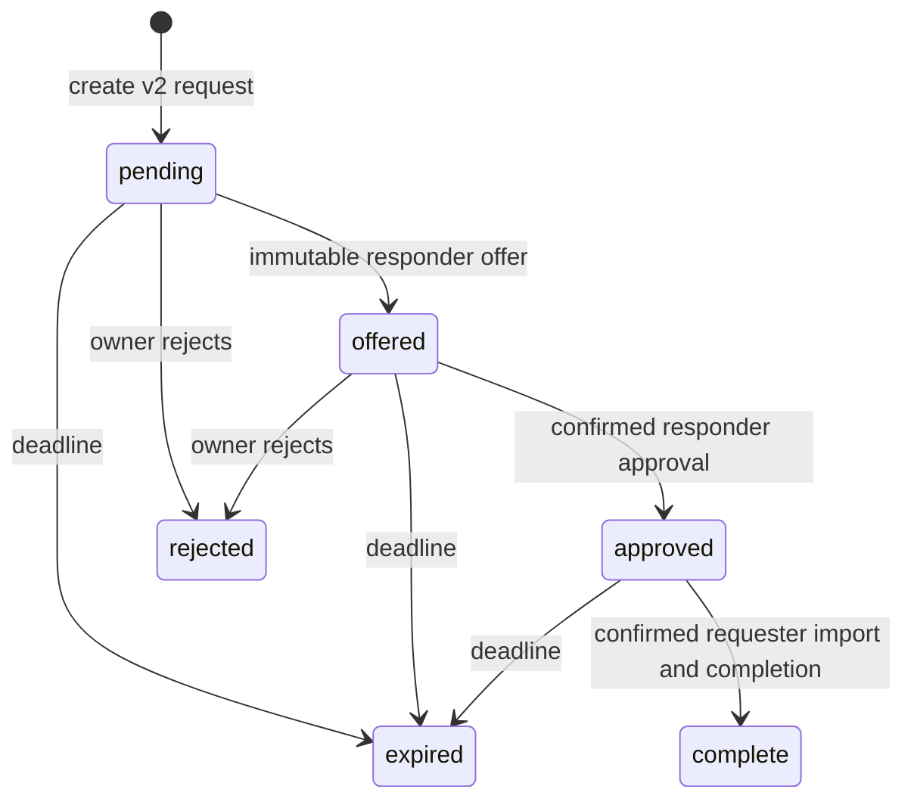

# Trusted-device recovery

Trusted-device recovery v2 transfers the original RSA account private key between
the recovering device (**requester**) and a signed-in device (**responder**).
Both devices display a fingerprint and require **These fingerprints match** for
the current exchange. Compare every group directly between the two devices using
an independent, trusted path. The relay's account checks and transcript hash do
not authenticate the peer.

This document describes the v2 implementation contract. Hosted deployment,
legacy retirement and packaged-desktop verification remain **UNVERIFIED**; see the
review and release evidence record.

## Ceremony and key custody

1. The requester captures its recovery token and selected server context, creates
   a non-exportable ephemeral P-384 private key and fresh nonce, and starts a v2
   request. It validates the returned context against those retained inputs.
2. On the signed-in device, **Review** creates ephemeral responder material and
   submits an immutable offer. This step does not read account or wrapping keys.
3. Both devices independently construct the transcript and derive its fingerprint.
   Each device requires its own explicit match confirmation for that digest.
4. Only responder confirmation permits account-key access, unwrap, temporary
   PKCS8 export and encrypted approval. **Approval submitted** acknowledges that
   submission; it does not claim the requester received the key.
5. Approval received before requester confirmation remains locked. Only after
   requester confirmation can it decrypt and validate the imported key, then
   acknowledge completion before continuing to the existing new-password flow.

Trusted recovery retains the same RSA identity and message access. Completion
does not consume the password-reset token; the existing reset flow consumes it,
rewraps the account key under the new password, rotates credentials and revokes
sessions. Recovery-key and explicitly consented destructive-reset paths retain
their existing behavior. Recovery Circle recovery is temporarily paused by C10a
(#3676): the five social-flow routes refuse share release, polling, listing and
approval after their existing parent gates. Saved configuration remains available
to its owner for management. The pause does not recall previously delivered shares.

Trusted-device v2 transcript composition and request completion remain unchanged.
C10c (#3687) owns future reuse of this transcript for Recovery Circle; the pause
does not implement that reuse or authenticate the separate Circle exchange.

## Canonical transcript and cryptography

Canonical bytes are UTF-8 of this compact JSON array in exactly this order, with
no whitespace or trailing newline:

```text
["concord-trusted-device-recovery",2,server_origin,request_id,account_binding,expires_at,requester_nonce,responder_nonce,recovery_token_jti_hash,"requester",requester_public_key,"responder",responder_public_key]
```

- `server_origin` is the selected API URL's canonical WHATWG HTTP(S) `.origin`,
  without credentials, path, query or fragment. Existing local-development and
  self-hosted HTTP origins remain supported; this protocol adds no TLS policy.
- `request_id` and the account UUID are canonical lowercase UUIDs. `expires_at`
  is an integer Unix-millisecond timestamp, bounded by the earlier of request
  creation plus 15 minutes and the validated recovery-token expiry.
- `account_binding` is padded standard base64 of SHA-256 over UTF-8
  `concord-trusted-device-recovery/account/v2`, one zero byte, then the account
  UUID. The requester uses its captured token's `user_id`; the responder uses
  local signed-in `user.id`; the server uses verified claims and the owned user
  row. Client token decoding supplies local context, not server authentication.
- `recovery_token_jti_hash` is SHA-256 over the verified JTI's UTF-8 bytes. The
  recovery table stores this hash, never the raw JTI. Each role nonce is 32 fresh
  CSPRNG bytes per attempt. Nonces and hashes are exactly 32 bytes.
- Binary fields use canonical padded standard base64: decoding and re-encoding
  must reproduce the original string. Public keys are exactly 97-byte,
  uncompressed, on-curve P-384 points beginning with byte `04`.

Let `H = SHA-256(canonical_bytes)`. Derive 384 P-384 ECDH bits with the
non-exportable ephemeral private key, then use HKDF-SHA256 with salt `H` and two
distinct exact UTF-8 labels:

| Output | HKDF label | Format |
| --- | --- | --- |
| Encryption key | `concord-trusted-device-recovery/v2/encryption` | Non-exportable AES-256-GCM key |
| Fingerprint | `concord-trusted-device-recovery/v2/fingerprint` | 128 bits, eight groups of four uppercase hexadecimal characters |

AES-GCM authenticates `H` as additional authenticated data (AAD), with a fresh
12-byte random IV and a 128-bit tag. The base64 envelope is
`02 || IV || ciphertext/tag`. Other envelope versions are refused; there is no
legacy fallback. ECDH-bit and temporary PKCS8 buffers are wiped in `finally`.
Ephemeral keys, fingerprints, confirmations and plaintext remain in memory and
never enter persistence, logs or telemetry.

The designated WebCrypto primitives live in
`client/desktop/src/renderer/utils/crypto/crypto.ts`; transcript and envelope
handling live in `trustedDeviceRecovery.ts`. Both role implementations and Go use
the shared [public synthetic protocol vectors](trusted-recovery-v2-vectors.json),
which contain test-only material rather than user keys or recovery tokens.

## API and server state

All paths below are under `/api/v1`; `protocol_version` is integer `2`.

| Operation | Authentication and behavior |
| --- | --- |
| POST `/auth/recovery/device-request` | Recovery token in the body; create validated immutable requester context in `pending` |
| GET `/auth/recovery/device-request/{id}` | Recovery-purpose Bearer token scoped to the requester user and JTI hash; poll retained context, offer and approved ciphertext |
| GET `/mfa/recovery-requests` | Access authentication; list owned, unexpired `pending`/`offered` requests without ciphertext |
| POST `/mfa/recovery-requests/{id}/respond` | Access authentication; exact mutually exclusive `offer`, `approve` or `reject` body |
| POST `/auth/recovery/device-request/{id}/complete` | Recovery-purpose Bearer token; body exactly `{protocol_version,transcript_hash}`; acknowledge confirmed decrypt/import |

The server recomputes account binding and the proposed offer's transcript hash.
Both clients independently validate that hash using their local role context;
later responses cannot replace captured context. An offer fixes the responder
key, nonce, digest and timestamp once. Approval carries only the offered digest
and bounded encrypted payload, never replacement keys or nonces. See
[OpenAPI](../api/openapi.yaml) for the exact DTOs and response shapes.



Transactions lock `users` before the recovery row. Responder writes enforce the
authenticated credential epoch. Requester recovery tokens have no credential
epoch, so completion uses recovery-purpose validation rather than access-token
middleware or an empty-epoch guard. After locks, expiry is checked against
`clock_timestamp()`. Each transition requires exactly one affected CAS row,
matching ownership, version and immutable context; post-offer writes also match
the offered key, nonce and digest. No transition renews expiry. Terminal
transitions clear ciphertext, terminal polls return metadata only, and expired
approved requests never disclose ciphertext.

Bodies are strictly validated as one JSON object, at most 16 KiB. Unknown,
duplicate, null, wrongly typed, case-alias and action-incompatible fields are
refused, as are trailing documents. Token length is at most 4096 characters,
origin at most 512 UTF-8 bytes, and decoded ciphertext 30–8192 bytes with prefix
`02`. Oversize bodies return 413; malformed or unsupported-version bodies 400;
invalid/expired tokens 401; missing/unowned requests 404; transition/digest
conflicts 409; dependency failures 500; rate limits 429 with `Retry-After`.
Unsupported versions include update/restart guidance.

Poll every three seconds without overlap and honor `Retry-After`; the poll budget
is 60 requests per minute per IP. Creation, listing and responder budgets retain
their existing limits. Lost acknowledgements do not prove success. The requester
reconciles authoritative polling state with its retained attempt before retry or
progression. The responder list exposes only `pending`/`offered` requests, so it
cannot positively reconcile a lost approval response: a missing row is not proof
of approval. Fail closed with restart guidance and never report success from that
absence.

## Lifecycle and limitations

Initial requester-echo and responder-list lifetime bounds allow two minutes of
clock skew, using a single captured receipt instant. The requester still caps
the echo at its captured recovery-JWT expiry. Neither role changes the wire
expiry or transcript: the requester pins its local operation deadline to the
earlier of that expiry and receipt plus 15 minutes; the responder uses the
earlier of that expiry and construction plus 15 minutes. Polls and HTTP Date
headers cannot renew or extend these deadlines.

Expiry, cancellation, unmount, account/server changes, E2EE teardown, context or
version mismatch and cryptographic failure invalidate confirmation and stale
continuations, then clear ephemeral/plaintext state. Sensitive operations and
publication recheck the digest, deadline and attempt/auth/server/E2EE generations.
Imported PKCS8 survives only the current password-rewrap flow and is wiped on
success, cancellation or teardown. Ordinary transport failures keep an unexpired
current attempt available with visible retry guidance.

Closing the responder clears its private attempt and confirmation and makes a
best-effort rejection of `pending`/`offered` requests. Without an acknowledgement,
the UI cannot claim remote rejection and retains the unresolved row. Reopening
an offered request without its local private key requires reject/restart; it
cannot resume the offer or replace the responder key.

All eight fingerprint groups remain visible, with separate explicit match
actions on both devices. The shared modal retains focus trapping and return;
group labels support character-by-character screen-reader comparison, status and
errors are announced, and reduced motion uses static progress. Browser,
keyboard, zoom and theme verification is recorded separately when performed.

Fingerprint comparison depends on a trusted path between the user's devices and
does not protect a compromised client or operating system. This change does not
authenticate the separate Recovery Circle exchange or remove the documented
password-observation limitation of password-based account-key wrapping.

Responder cleanup wipes the private attempt immediately. Its deferred remote
rejection is canceled if React immediately re-arms the effect during StrictMode
replay. Explicit close uses the captured account/server/auth/key/expiry guard
that remains valid after modal unmount; a matching acknowledgement may remove
the row only while that context is current. Neither path claims rejection from
a failed or ambiguous response.

## Compatibility, migration and release verification

The v2 server unconditionally refuses v1; no legacy-acceptance flag is provided.
Stage the v2 schema and control plane before the desktop rollout. This order
temporarily interrupts trusted recovery for old clients: update and restart both
devices, then start a fresh request. Other recovery methods remain available.

Migration `000163` locks `recovery_requests` and drains only the historical
15-minute ephemeral ceremonies before installing hash-only v2 fields. It does
not delete accounts, trusted devices, Recovery Circle records or account keys.
Users must restart requests; the old ceremonies are not recoverable.

The paired down migration takes the same lock and refuses unexpired
`pending`/`offered`/`approved` v2 requests. After draining terminal/expired rows,
it restores the empty prior schema without reconstructing raw JTI or approval
material. Any rollback must preserve v1 refusal and must never restore the old
vulnerable approval binary. Representative table-lock duration is unverified.

Release evidence is **UNVERIFIED** until the following observations are recorded:

- [ ] Identify the deployed hosted control-plane build and schema migration.
- [ ] Verify the desktop build on both devices after update/restart.
- [ ] Complete a legitimate hosted v2 fingerprint ceremony with the same RSA identity.
- [ ] Confirm the deployed service refuses legacy recovery with update guidance.
- [ ] Record staged rollout, ceremony-restart messaging and safe rollback readiness.

Merge closes the requested implementation and integration scope for
#2550,
#2621 and
#2622 through
#3582, as requested.
Issue closure and local checks do not prove deployment or hosted retirement.
The control-plane/desktop rollout and deployed v1-refusal observations remain the
separate, unchecked release checklist above.
